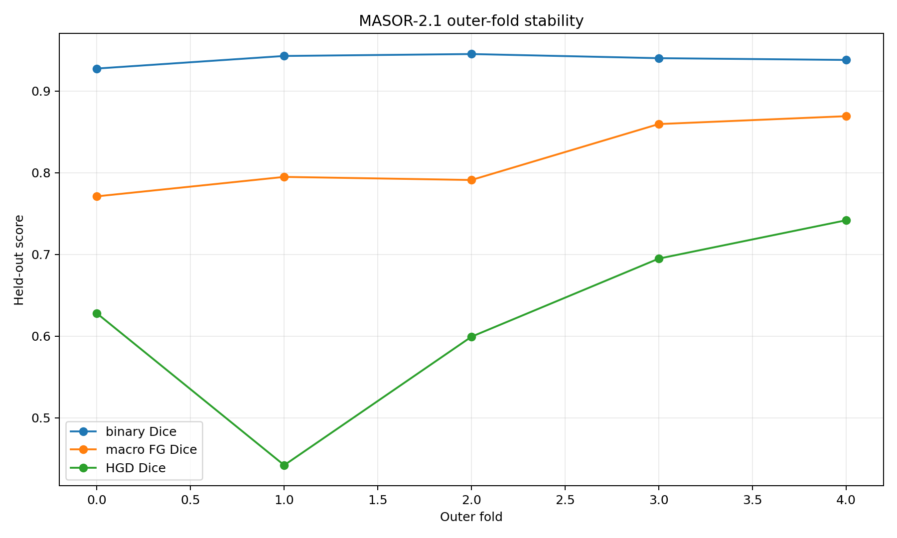

# MASOR 2.1
### Multi-task, ordinal-aware segmentation of colorectal histopathology

**Sara-Mihaela Șova** · Medical Student, Carol Davila University of Medicine and Pharmacy · Research, Victor Babeș National Institute of Pathology

MASOR 2.1 is a computational-pathology research pipeline for **tissue localisation, histological segmentation and ordinal-aware grading** of H&E colorectal biopsy images. It combines a **ConvNeXt-Tiny backbone with an FPN-style decoder and task-specific modelling** and was evaluated using **five-fold grouped cross-validation**.

## Results at a glance

| Out-of-fold metric | Result | 95% bootstrap interval |
|:--|--:|:--|
| **Binary tissue localisation Dice** | **0.939** | 0.934–0.943 |
| **Macro foreground Dice** | **0.815** | 0.783–0.843 |
| **Low-grade Dice** | **0.913** | 0.892–0.931 |
| **Adenocarcinoma Dice** | **0.869** | 0.850–0.887 |
| Normal gland Dice | 0.852 | 0.770–0.913 |
| High-grade Dice | 0.625 | 0.544–0.692 |

**1,694 evaluated images · 376 source groups · five outer folds · 5,000 bootstrap replicates.** The table reports bootstrap means computed from the saved OOF analysis, with intervals supplied by the experiment export.



## Dataset: EBHI-Seg

[EBHI-Seg](https://figshare.com/articles/dataset/EBHI-SEG/21540159) is a public dataset of **H&E-stained colorectal biopsy histopathology images**, introduced by Shi et al. (2023). The original publication describes **2,228 histology images and 2,228 paired ground-truth images**, with six original diagnostic groups: normal, polyp, low-grade intraepithelial neoplasia, high-grade intraepithelial neoplasia, serrated adenoma and adenocarcinoma. The published images are 224 × 224 pixels.

**MASOR 2.1 uses a defined four-category subset / mapping**, rather than all six original classes:

| MASOR label | Images | Ordinal index |
|:--|--:|--:|
| Normal gland | 76 | 0 |
| Low-grade | 637 | 1 |
| High-grade | 186 | 2 |
| Adenocarcinoma invasion | 795 | 3 |
| **Total** | **1,694** | |

These are the **exact counts in `master_manifest.csv`**, not the full original EBHI-Seg distribution. In the model's semantic evaluation, background is an additional segmentation label; it is **not** an extra image-diagnosis category. Original EBHI-Seg ground-truth images and the MASOR experiment's derived/reference masks should not be assumed interchangeable without reviewing preprocessing.

**Dataset paper:** Shi L. et al. *EBHI-Seg: A novel enteroscope biopsy histopathological hematoxylin and eosin image dataset for image segmentation tasks.* Frontiers in Medicine, 2023. DOI: [10.3389/fmed.2023.1114673](https://doi.org/10.3389/fmed.2023.1114673).

## Proposed methodological contributions

MASOR 2.1 proposes an **annotation-aware, ordinal-prototype framework** for colorectal histopathology. Its methodological contribution lies in integrating the following design choices into a single trainable segmentation pipeline, rather than in claiming that any individual component was invented here.

1. **Decoupled localisation and histological grading.** An independently supervised binary foreground head learns tissue localisation from EBHI-Seg's segmentation annotations. Grade inference is restricted to the estimated foreground, avoiding the assumption that the image-level histological diagnosis is a manually annotated dense grade map.
2. **Structurally ordered, trainable morphological prototypes.** A shared ConvNeXt-Tiny/FPN feature extractor generates a 64-dimensional dense morphology representation. Instead of a conventional independent 1×1 multiclass segmentation head, MASOR learns four prototype positions along a common ordinal axis. Positive gaps, parameterised through softplus and cumulative sums, enforce the progression **normal → low-grade → high-grade → adenocarcinoma**. Per-pixel grade logits are computed from distances to these prototypes, with learned class biases and small prototype residuals.
3. **Feature-level H&E stain invariance.** Spatially matched clean and H&E-perturbed views are used for an InfoNCE-style contrastive objective on the *shared morphology features*, rather than on the predicted class logits. Stain normalisation is deliberately omitted from this experiment.
4. **EMA-based weak-label refinement.** An exponential-moving-average teacher produces soft, ordinal-adjacent pseudo-targets after warm-up, complementing weak dense supervision derived from the image-level label and the foreground mask.
5. **Grade-sensitive learning under class imbalance.** Foreground-masked log-sum-exp pooling provides image-level supervision with sensitivity to severe regions. A high-grade neighbour-margin objective specifically addresses the confusion between low-grade, high-grade and invasive adenocarcinoma. Group-aware sampling and fold-specific weighting are used instead of high-grade cut-and-paste augmentation.
6. **Leakage-conscious evaluation and calibration.** Five outer grouped folds are combined with **validation-only** selection of localisation thresholds and image-prior strength; checkpoint selection uses class-balanced foreground metrics. The saved evaluation includes out-of-fold predictions, group-based bootstrap uncertainty and a separate stain-perturbation audit.

### Relationship to prior work and research hypothesis

Weakly supervised histology segmentation, prototype-based feature learning, contrastive stain robustness and EMA/self-training have precedents in the literature. For example, Safdari *et al.* (2025) investigate contrastive learning and self-training for weakly supervised histology segmentation, while Tang *et al.* (CVPR 2025) describe prototype-based prompting for histopathological segmentation. MASOR's **specific technical proposal** is to couple **explicitly ordered, trainable prototype geometry** to an **annotation-aware localisation/grade decomposition**, with additional feature-level stain invariance and high-grade-focused optimisation.

**Research hypothesis:** this formulation can support ordinal consistency and improve grade-sensitive tissue mapping under incomplete pixel-level grade annotations, while retaining robust foreground localisation. The five-fold results below evaluate the integrated system; **component-level causality and comparative superiority remain to be established through controlled ablations on identical splits**.

Selected related work:
- Safdari R. *et al.* (2025). [Weakly-supervised semantic segmentation in histology images using contrastive learning and self-training](https://doi.org/10.1016/j.compbiomed.2025.110321).
- Tang Q. *et al.* (CVPR 2025). [Prototype-Based Image Prompting for Weakly Supervised Histopathological Image Segmentation](https://openaccess.thecvf.com/content/CVPR2025/html/Tang_Prototype-Based_Image_Prompting_for_Weakly_Supervised_Histopathological_Image_Segmentation_CVPR_2025_paper.html).

## Modelling and evaluation

1. **Backbone and multi-task formulation.** ConvNeXt-Tiny features with FPN-style multiscale decoding; binary localisation, semantic segmentation and ordinal-aware histological representation.
2. **Ordinal progression.** The experiment explicitly encodes the order normal → low-grade → high-grade → adenocarcinoma, rather than treating all grades as unrelated categories.
3. **Group-aware validation.** The 1,694 images were assigned across five outer test folds with 376 unique source-group identifiers. Inspection of `master_manifest.csv` confirms each `group_key` belongs to exactly one outer fold.
4. **Thresholded post-processing.** Fold-specific binary localisation thresholds (0.35, 0.40, 0.55, 0.50, 0.50) with `prior_lambda=0.75` in the supplied fold exports.
5. **Metrics and uncertainty.** Dice/IoU by class and fold, pooled out-of-fold bootstrap estimates with 5,000 replicates, and fold-stability visualisation.

### Five-fold performance

| Fold | Test images | Source groups | Localisation Dice | Macro foreground Dice | Adenocarcinoma Dice |
|--:|--:|--:|--:|--:|--:|
| 0 | 333 | 74 | 0.927 | 0.771 | 0.829 |
| 1 | 324 | 75 | 0.943 | 0.795 | 0.872 |
| 2 | 312 | 75 | 0.945 | 0.791 | 0.869 |
| 3 | 359 | 75 | 0.940 | 0.859 | 0.892 |
| 4 | 366 | 77 | 0.938 | 0.869 | 0.878 |

**What stands out:** strong binary localisation across all five outer folds (Dice **0.927–0.945**), high performance for low-grade and adenocarcinoma categories, and improved macro foreground Dice in folds 3–4. High-grade morphology is the most variable category and an explicit subject for further analysis.

## Experiments

**Primary:** MASOR 2.1 training/evaluation notebook and outputs (`notebooks/`, `results/`, `figures/`).

**Baseline:** a distinct YOLO26m semantic-segmentation experiment (`baselines/`) using **407 paired tiles from 62 source slides, six pixel labels, and a slide-level train/validation/test split**. Its held-out test output is **mIoU 0.402** and **pixel accuracy 0.644**. This is a separate dataset/protocol and therefore **not a like-for-like performance comparison** against MASOR 2.1.

## Repository contents

```text
notebooks/       MASOR 2.1 training/evaluation
baselines/       YOLO26 semantic experiment and configuration
preprocessing/   slide/tissue/tile extraction utilities
results/         OOF statistics, fold comparisons, manifests
figures/         visual predictions and fold-stability analysis
checkpoints/     checkpoint notes and provenance
```

## Reproducing the work

Use the experiment notebooks with their pinned library versions and the appropriate EBHI-Seg-derived data layout. The full trained fold-2 checkpoint is a separate binary artefact; inference validation is in progress. Original images are obtained from the public dataset provider rather than included in Git.

**Scope of claims:** these are strong results within the **reported grouped out-of-fold research evaluation**; they are not clinical deployment metrics or an independent external-hospital validation. Some mask references in this pipeline are derived/weak labels, a relevant consideration for interpreting Dice.

## Research affiliation, coordination and acknowledgements

**Sara-Mihaela Șova** — implementation, model development, experiments, evaluation and repository documentation; third-year medical student, **Carol Davila University of Medicine and Pharmacy (UMFCD), Bucharest**.

**Leonard Savu** — research collaborator; second-year medical student, **Carol Davila University of Medicine and Pharmacy (UMFCD), Bucharest**.

**Research institution and laboratory:** **“Victor Babeș” National Institute of Pathology, Laboratory of Ultrastructural Pathology** (*Laboratorul de Patologie Ultrastructurală*), Bucharest.

**Research supervisor and laboratory head:** **Dr. Emanuel Tudor Fertig — Lecturer and Head of the Laboratory of Ultrastructural Pathology** (*Șef lucrări, șef de laborator*).

The project was developed in the context of research activities at the Laboratory of Ultrastructural Pathology, with collaboration between Sara-Mihaela Șova and Leonard Savu under the supervision of Dr. Emanuel Tudor Fertig.

---

*Research software — not for clinical diagnosis.*
